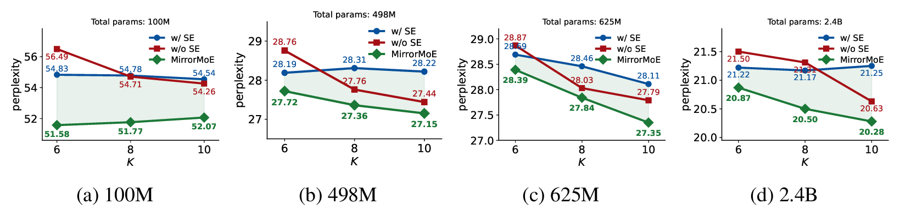

# MirrorMoE

Code for the paper **Rethinking Routing Exploration in Modern Mixture-of-Experts**.

## The exploration dilemma

Modern Mixture-of-Experts (MoE) models combine two design choices that pull in opposite directions:

- **Fine-grained expert segmentation** uses many small experts and activates more of them per token. This enlarges the routing space combinatorially: going from (E, K) = (8, 1) to (64, 8) raises the number of expert combinations from 8 to about 4.4 × 10⁹. Finding good combinations in a space this large takes **more exploration** during pretraining.
- **Shared experts** are active for every token and capture common knowledge. They also make routing **less exploratory**. Shared experts dominate the learned token representation, so activating different routed experts changes the layer output only a little, and alternative routes become hard to tell apart.

The paper calls this conflict the **exploration dilemma**. In practice, the benefit of shared experts fades as the number of activated experts K grows. The extra expressiveness of a larger K is also not realized, and a standard shared-expert MoE can even get worse as K increases.

## MirrorMoE

Rather than forcing more exploration, MirrorMoE **shrinks the exploration space** to match what the model can explore. It suppresses unnecessary experts, adapting to each token:

```
ξ = softmax(Gh)            # standard routing distribution, favors large logits
ζ = softmax(-Gh)           # mirrored distribution (sign-negated logits), favors small logits
p = (1 - ρ)·ξ + ρ·ζ        # mirror routing: activate the top-k routed experts by p
```

- **Mirror routing:** experts are selected by `p`, which moves routing probability toward both ends of the logit range.
- **Mirror aggregation:** the selected experts' outputs are weighted by `ξ`, not `p`. Experts selected through the mirrored term have a tiny `ξ`. They're activated but add almost nothing to the output, so they're functionally suppressed. How many experts get suppressed varies across tokens and layers.
- **Annealing:** ρ is cosine-annealed from ρ₀ = 0.4 to 0, so the routing space gradually reopens once experts have specialized, and training ends with standard top-k routing:
- **Load balancing** is computed on `ξ`, so it focuses on the experts that actually contribute.

## Results



*Figure 1. comparison of MoEs with and without shared experts (SE) and MirrorMoE. MirrorMoE consistently i) achieves the best performance, ii) realizes the expressiveness gains from larger K, and iii) enables shared-expert MoEs to outperform their non-shared counterparts.*

K is the total number of activated experts per token, including the shared ones. The release scripts in this repository use K = 8.

This repository contains the Megatron-LM implementation and the launch scripts. It builds on [FLAME-MoE](https://github.com/cmu-flame/FLAME-MoE).

---

## 🚀 Getting Started

### 1. Clone the Repository

```bash
git clone <repo-url> MirrorMoE
cd MirrorMoE
```

Run all commands below from the repository root. The scripts use paths relative to it.

### 2. Set Up the Environment

Set up the conda environment with the provided installer:

```bash
bash scripts/miscellaneous/install.sh
conda activate mirrormoe
```

The installer:
1. Downloads apex and TransformerEngine at the commits FLAME-MoE pins. It skips this if the `apex/` or `TransformerEngine/` folder already exists.
2. Creates a Python 3.10 conda environment named `mirrormoe`. Set `ENV_NAME` to use a different name. If an environment with that name already exists, it's reused.
3. Installs PyTorch 2.6.0 (CUDA 12.4 build).
4. Runs `install_local.sh`, which installs the Megatron-LM requirements and other Python packages, then builds apex and TransformerEngine with your CUDA toolkit.

You need Linux with NVIDIA GPUs (the release scripts use one node with 4 GPUs), conda, and a CUDA 12 toolkit with `nvcc` to build apex and TransformerEngine. Version 12.4 matches the PyTorch build.

Other installers, for specific cases:

| Installer | When to use it |
|---|---|
| `scripts/miscellaneous/install_local.sh` | Install into the conda environment that's already active. It needs Python 3.10 and the `apex/` and `TransformerEngine/` folders. If PyTorch isn't installed yet, it picks a build matching your CUDA version. |
| `scripts/miscellaneous/install_local.sh tokenize` | Install only what data preparation needs |
| `scripts/miscellaneous/install_local_te.sh` | Rebuild TransformerEngine if its build failed, or add flash-attn |

The installer sets up the same software stack as FLAME-MoE:

| Component | Version |
|---|---|
| Python | 3.10 |
| PyTorch | 2.6.0, CUDA 12.4 build |
| Megatron-LM | Megatron Core 0.12, included in `Megatron-LM/`: FLAME-MoE's fork ([yuzc19/Megatron-LM](https://github.com/yuzc19/Megatron-LM) at commit `cbaf684`) plus the MirrorMoE changes |
| TransformerEngine | 1.11.0, commit `fc03478` (branch `release_v1.11`), built from source |
| apex | commit `c02c6c8`, built from source |

---

## 📚 Data Preparation

### 3. Configure Paths

Edit `devconfig.sh` for your machine:

| Variable | Purpose |
|---|---|
| `TOKENIZED_DIR` | Tokenized training data. Training reads every `*.bin` file in this folder. |
| `SSD_MOUNT` | Scratch space for raw downloads during data preparation |
| `NFS_MOUNT` | Task queue for data preparation |
| `TOKENIZER` | Tokenizer used for data preparation. Must match `--tokenizer-model` in `configs/model/*.sh` (`EleutherAI/pythia-12b`). |

Checkpoints are written to `TRAIN_WEIGHTS`, which defaults to `/local/home/bingli/moe/<run name>`. Change that default in `scripts/training/mirror-moe.sh` and `scripts/training/flame-moe.sh`, or set `TRAIN_WEIGHTS` for each run (see [Customizing a run](#customizing-a-run)).

### 4. Download and Tokenize the Dataset

MirrorMoE trains on one shard of [DCLM-baseline](https://huggingface.co/datasets/mlfoundations/dclm-baseline-1.0) (`global-shard_03_of_10/local-shard_1_of_10`, called `dclm28b` in the scripts), tokenized with the `EleutherAI/pythia-12b` tokenizer. 

```bash
bash scripts/dataset/prepare.sh
```

This downloads the shard from HuggingFace. It tokenizes each file with Megatron-LM's `tools/preprocess_data.py`, writes the `.bin`/`.idx` files to `TOKENIZED_DIR`, and deletes each raw file once it's tokenized. Progress is tracked in a task queue in `NFS_MOUNT`, so if it's interrupted you can rerun the same command to continue.

Training splits the data 90/5/5 into train, validation and test.

---

## 🧠 Training

### 5. Train MirrorMoE Models

Launch training with one of the release scripts:

```bash
bash scripts/release/mirror-moe-100m-a38m.sh
```

Each model size has a MirrorMoE script and a baseline script. The baseline is the same shared-expert MoE with standard top-k routing ("standard routing" in the results above). Apart from the run name and W&B run label, it differs from MirrorMoE only by the two router flags in `configs/model/mirror-moe.sh`.

The 100M/38M baseline is FLAME-MoE's 38M recipe (released as [FLAME-MoE-38M-100M](https://huggingface.co/CMU-FLAME/FLAME-MoE-38M-100M)). FLAME-MoE trained it on 4 nodes × 8 GPUs; here it runs on one 4-GPU node with the same global batch size, using more gradient-accumulation steps.

| Model (total / active params) | MirrorMoE | Baseline | Run names (MirrorMoE / baseline) |
|---|---|---|---|
| 100M / 38M | `scripts/release/mirror-moe-100m-a38m.sh` | `scripts/release/moe-100m-a38m.sh` | `mirror-moe-38m` / `flame-moe-38m` |
| 498M / 121M | `scripts/release/mirror-moe-498m-a121m.sh` | `scripts/release/moe-498m-a121m.sh` | `mirror-moe-150m` / `flame-moe-150m` |
| 625M / 100M | `scripts/release/mirror-moe-625m-a100m.sh` | `scripts/release/moe-625m-a100m.sh` | `mirror-moe-150m-wide` / `flame-moe-150m-wide` |
| 2.4B / 270M | `scripts/release/mirror-moe-2.4b-a270m.sh` | `scripts/release/moe-2.4b-a270m.sh` | `mirror-moe-270m` / `flame-moe-270m` |

### Outputs

- **Checkpoints:** saved every `SAVE_INTERVAL` iterations (set in each release script) to `TRAIN_WEIGHTS`.
- **Validation loss:** computed every `EVAL_INTERVAL` iterations on the validation split.
- **Logs:** sent to the W&B project `moe-<size>` (for example `moe-38m`), grouped by run name. TensorBoard logs are written to the checkpoint folder. Run `wandb login` first, or set `WANDB_MODE=offline` to skip uploading.

### Customizing a run

| Setting | How to change it |
|---|---|
| Learning rate | Edit `LR` and `MIN_LR` in the release script. Keep `MIN_LR` ≤ `LR`. |
| Maximum ρ | Edit `MOE_ROUTER_RHO` in `configs/model/mirror-moe.sh` |
| ρ schedule | Remove `--moe-router-cosine-rho` from `configs/model/mirror-moe.sh` to keep ρ constant |
| Number of GPUs | `NPROC_PER_NODE=8 bash scripts/release/...` (must be a multiple of the script's `EXPERT_MODEL_PARALLEL_SIZE`) |
| Global batch size | `GLOBAL_BATCH_SIZE=...` (must be divisible by `MICRO_BATCH_SIZE` × number of GPUs) |
| Checkpoint folder | `TRAIN_WEIGHTS=/path/to/run` |
| Training data | `TRAIN_DATASET=/path/to/tokenized` |
| W&B project / entity | `WANDB_PROJECT=...`, `WANDB_ENTITY=...` |
| Two runs on one machine | Give each run its own `RDZV_ENDPOINT=localhost:<port>` |

### Notes

- **Resuming:** rerun the same release script. Training continues from the latest checkpoint in `TRAIN_WEIGHTS`, and the ρ schedule continues from that iteration.
- **New hyperparameters need a new run name.** Megatron refuses to resume from a checkpoint trained with a different learning-rate schedule, and stops with a "do not match" error. Change `JOB_NAME` in the release script, and keep the size tag in it (for example `mirror-moe-38m-lr1e-3`), because the W&B project name is read from it.
- **Using MirrorMoE checkpoints outside training:** ρ only follows its schedule inside Megatron's training loop. Anywhere else, for example in a standalone evaluation script that loads `configs/model/mirror-moe.sh`, it falls back to ρ = 0.4. To match how training ended, run the final checkpoint with `--moe-router-rho 0` and without `--moe-router-cosine-rho`.

---

## 🧩 Where MirrorMoE Lives in Megatron-LM

Core of MirrorMoE is in [`Megatron-LM/megatron/core/transformer/moe/router.py`](Megatron-LM/megatron/core/transformer/moe/router.py).

---

## 🙏 Acknowledgements

This code builds on [FLAME-MoE](https://github.com/cmu-flame/FLAME-MoE) ([paper](https://arxiv.org/abs/2505.20225)), which provides the data pipeline, the training recipe and the Megatron-LM fork, and on [NVIDIA Megatron-LM](https://github.com/NVIDIA/Megatron-LM) (Megatron Core 0.12). Megatron-LM's license is in `Megatron-LM/LICENSE`.
